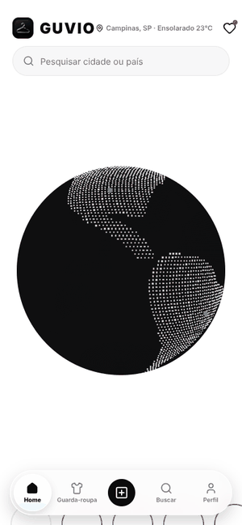

# GUVIO

**Social fashion app with an interactive 3D globe.** Explore looks from cities around the world, build outfits from your wardrobe and share them with the community.

Built with **React Native + Expo + TypeScript**, running on Android, iOS and the web.

🌐 **Live web demo:** https://wondrous-cocada-999321.netlify.app
*(create any account to get in; in demo mode, accounts are stored only in your browser)*

<p align="center">
  
</p>

## ✨ Features

- 🌍 **Interactive 3D globe** built with Three.js / React Three Fiber: particle-rendered continents, free rotation, location markers and animated arcs between cities
- 🔎 **Worldwide city and country search** (countries.dev, no API key) that rotates the globe to the selected place and filters the feed
- 📰 **Social feed** with likes (including double-tap), saves, comments, sharing and skeleton loaders
- 📖 **Stories** with a full-screen viewer
- 💬 **Direct messages**, including image sending
- 👗 **Wardrobe** with outfit building and weather-based outfit suggestions
- 🌤️ **Local weather** for the selected city
- 👤 **Profiles**: your profile, public profiles, follow, activity, saved posts and settings
- 🔐 **Authentication** with email, Google and Apple via Supabase, with a local demo mode when Supabase isn't configured
- ⚡ **Real-time sync** of posts and likes through Supabase Realtime channels
- 🌗 **Light / dark theme** and a custom "liquid glass" bottom navigation that follows your finger

## 🧰 Tech stack

| Area | Tools |
|---|---|
| Framework | React Native 0.81 · Expo SDK 54 · React 19 |
| Language | TypeScript |
| 3D | Three.js · React Three Fiber · expo-gl |
| Backend | Supabase (Auth REST + Realtime) |
| Storage | AsyncStorage · expo-secure-store |
| Build & delivery | EAS Build · EAS Update · Netlify (web) |
| Other | expo-image · expo-notifications · expo-image-picker · expo-blur · Lucide icons |

## 📁 Project structure

```
src/
├── components/   # UI: Globe3D, HomeFeed, StoryViewerModal, DirectView, WardrobeView, ProfileViews...
├── context/      # App theme (light/dark)
├── data/         # Demo data for feed, profiles and wardrobe
├── services/     # Auth, Supabase sync, realtime, storage, weather, outfit suggestions, notifications
└── styles/
docs/             # Sprint notes and demo GIF
```

## 🚀 Running locally

**Requirements:** Node.js 18+ and the [Expo Go](https://expo.dev/go) app on your phone.

```bash
git clone https://github.com/whoistavs/guvio-app.git
cd guvio-app
npm install
cp .env.example .env   # optional: add your Supabase URL and anon key
npm start
```

Scan the QR code with Expo Go (Android) or the Camera app (iOS).

| Script | What it does |
|---|---|
| `npm start` | Start Expo |
| `npm run lan` | Start on your local network |
| `npm run iphone` | Start with a tunnel (useful on restricted networks) |
| `npm run web` | Run in the browser |
| `npm run build:web` | Export the static web version to `dist/` |
| `npm run build:apk` | Build an Android APK with EAS |
| `npm run check` | Type-check with TypeScript |

## ⚙️ Environment variables

| Variable | Description |
|---|---|
| `EXPO_PUBLIC_SUPABASE_URL` | Your Supabase project URL |
| `EXPO_PUBLIC_SUPABASE_ANON_KEY` | Your Supabase anon key |

Both are optional. Without them the app runs in demo mode with local data.

## 👥 Authors

- **Octavio Rodrigues Schwab** · mobile developer · [GitHub](https://github.com/whoistavs) · [LinkedIn](https://www.linkedin.com/in/octavio-schwab)
- **Gustavo Reis** · [GitHub](https://github.com/gustavogreis)
